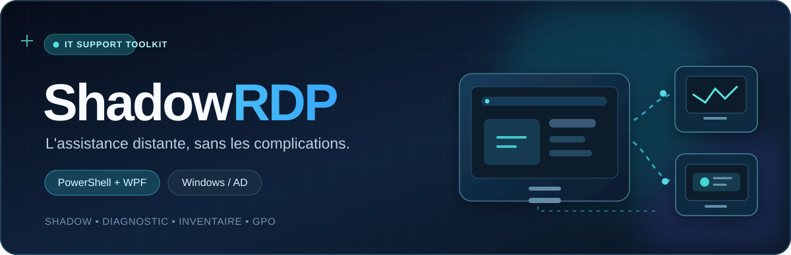
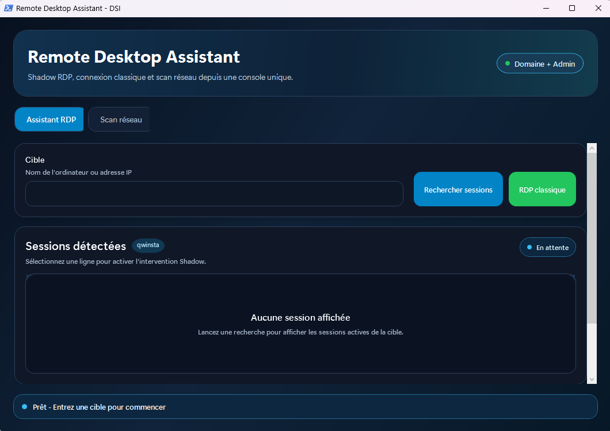
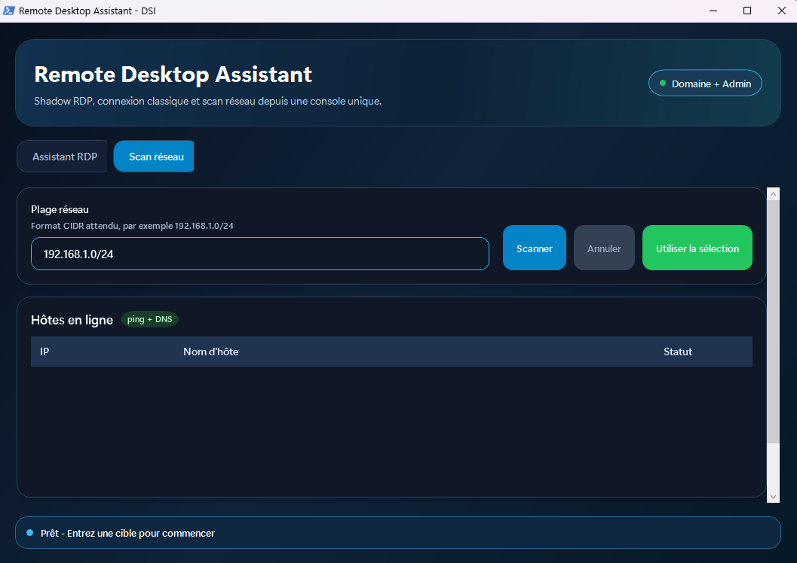

<div align="center">



<br/>

**Une console Windows pour voir, diagnostiquer et assister un poste distant — sans serveur, sans agent, sans usine à gaz.**

<br/>

[](https://github.com/neosoda/ShadowRDP/releases/latest)
[](#prérequis)
[](#prérequis)
[](https://github.com/neosoda/ShadowRDP/actions/workflows/powershell.yml)
[](#comment-ça-marche)

<br/>

[**Découvrir**](#en-un-coup-dœil) &nbsp;·&nbsp;
[**Captures**](#interface) &nbsp;·&nbsp;
[**Installer**](#démarrage-rapide) &nbsp;·&nbsp;
[**Déployer par GPO**](GPO-DEPLOYMENT.md) &nbsp;·&nbsp;
[**Télécharger**](https://github.com/neosoda/ShadowRDP/releases/latest)

</div>

---

## ✦ En un coup d'œil

ShadowRDP rassemble dans une **seule interface WPF** les outils du support informatique Windows : recherche de sessions, Shadow RDP, connexion classique, diagnostic réseau et découverte d'hôtes.

<table>
<tr>
<td width="50%" valign="top">

### 🖥️ Prise en main

- **Shadow RDP** : visualisation ou contrôle d'une session utilisateur.
- **RDP classique** en un clic.
- Énumération des **sessions réellement actives**.
- **Timeout** pour ne pas attendre indéfiniment une cible inaccessible.
- **Favoris** et derniers postes consultés.

</td>
<td width="50%" valign="top">

### 🩺 Diagnostic intégré

- Résolution **DNS / IP**.
- Test **ICMP** sans considérer son absence comme une panne.
- Vérification **RDP 3389**, **RPC 135** et **SMB 445**.
- Interrogation des sessions et remontée des erreurs.
- Recherche de postes **Active Directory** sans RSAT.

</td>
</tr>
<tr>
<td valign="top">

### 📡 Découverte réseau

- Scan IPv4 **CIDR**, jusqu'à **1 024 adresses**.
- **16 pings asynchrones** en parallèle.
- **DNS inverse asynchrone** pour garder la fenêtre réactive.
- Résultats progressifs, annulation et **export CSV**.
- Transfert d'un poste vers l'assistant en un clic.

</td>
<td valign="top">

### 🛡️ Déploiement maîtrisé

- Préparation des postes par **GPO de démarrage**.
- Configuration **RDP / NLA / Shadow / pare-feu**.
- **Consentement requis par défaut** pour le contrôle.
- Sauvegarde initiale des paramètres et **restauration** au retrait.
- WinRM et règles distantes étendues **optionnels**.

</td>
</tr>
</table>

## ✦ Interface

<div align="center">
<table>
<tr>
<td width="50%" align="center">

<br/>
<sub><b>Assistant RDP</b> — sessions et modes d'intervention</sub>
</td>
<td width="50%" align="center">

<br/>
<sub><b>Scan réseau</b> — découverte des postes</sub>
</td>
</tr>
</table>
</div>

> [!NOTE]
> Ces captures illustrent l'interface historique. La version 1.5 ajoute notamment les favoris, le diagnostic et la recherche AD ; des captures actualisées seront intégrées après validation de l'interface sur Windows.

## ✦ Démarrage rapide

**1.** Récupérer la [dernière version](https://github.com/neosoda/ShadowRDP/releases/latest), puis extraire l'archive dans un dossier local.

**2.** Depuis un poste Windows d'administration, lancer :

```text
RemoteDesktopAssistant.cmd
```

**3.** Entrer le **nom d'un PC ou son IP**, puis cliquer sur **Rechercher sessions**, **Diagnostiquer** ou **RDP classique**.

> [!TIP]
> Le lanceur `RemoteDesktopAssistant.cmd` gère l'élévation. Aucun serveur ShadowRDP ni agent spécifique n'est à installer sur les postes cibles. Les **services et règles Windows nécessaires** doivent en revanche être configurés sur ces postes.

### Prérequis

| Composant | Configuration |
|:--|:--|
| Poste opérateur | Windows 10/11 ou Windows Server avec interface graphique |
| PowerShell | **Windows PowerShell 5.1**, exécution en **64 bits** recommandée |
| Droits | Administrateur local sur les machines ciblées selon l'opération |
| Réseau | Accès aux services Windows RDP/RPC nécessaires |
| Active Directory | **Facultatif** pour l'interface ; requis pour le déploiement par GPO |

> [!IMPORTANT]
> Le code est analysé et testé automatiquement sur Windows, mais les scénarios de **prise en main réelle et de déploiement GPO** doivent être validés dans votre environnement avant généralisation.

## ✦ Comment ça marche

```text
      POSTE OPÉRATEUR                             POSTES WINDOWS
 ┌──────────────────────────┐                 ┌──────────────────────┐
 │  ShadowRDP (WPF)         │                 │  Session utilisateur │
 │  • Sessions / qwinsta    │ ─── RPC ──────▶ │  Services Windows    │
 │  • Shadow / mstsc        │ ─── RDP ──────▶ │  RDP + stratégie     │
 │  • DNS / ICMP / TCP      │ ─── Réseau ───▶ │  Pare-feu ciblé      │
 │  • Favoris / recherche AD│                 └──────────────────────┘
 └──────────────────────────┘
               │                                     ▲
               │      GPO machine (facultative)      │
               └─────────────────────────────────────┘
```

Deux scripts distincts, une seule logique : **l'opérateur pilote depuis l'interface ; la GPO prépare les postes**. L'assistant fonctionne sans infrastructure ShadowRDP centrale.

### Modes d'intervention Shadow

| Stratégie Windows `Shadow` | Comportement |
|:--:|:--|
| **1 — par défaut** | Contrôle total **avec consentement** |
| 2 | Contrôle total **sans consentement** |
| 3 | Visualisation seule **avec consentement** |
| 4 | Visualisation seule **sans consentement** |
| 0 | Shadow interdit |

Le mode sans consentement ne doit être utilisé que dans un **cadre d'administration autorisé et documenté**. Il n'est **pas activé par défaut** par ShadowRDP 1.5.

## ✦ Déploiement des postes

Le module `Deploy-RDPGPO.ps1` prépare les postes : stratégie Shadow, RDP/NLA, service `RemoteRegistry`, règles pare-feu et suivi local de l'état du déploiement.

```powershell
# Audit : afficher les modifications envisagées
powershell.exe -NoProfile -File .\Deploy-RDPGPO.ps1 -WhatIf

# Appliquer la configuration par défaut (avec consentement)
powershell.exe -NoProfile -File .\Deploy-RDPGPO.ps1

# Optionnel : activer les groupes de règles WMI/SMB/journaux distants
powershell.exe -NoProfile -File .\Deploy-RDPGPO.ps1 -EnableExtendedFirewallRules

# Restaurer l'état initial sauvegardé
powershell.exe -NoProfile -File .\Deploy-RDPGPO.ps1 -Uninstall
```

<details>
<summary><b>Paramètres de sécurité par défaut</b></summary>

| Paramètre | Valeur |
|:--|:--|
| `ShadowMode` | `1` — contrôle avec consentement |
| `AllowedRemoteAddresses` | `LocalSubnet` |
| `MaxAgeDays` | `0` — contrôle à chaque exécution |
| `EnableWinRM` | Désactivé |
| `EnableExtendedFirewallRules` | Désactivé |
| Redémarrage de `TermService` | Non |
| Sauvegarde d'état | `%ProgramData%\ShadowRDP\deployment-backup.json` |

**Attention :** si la sauvegarde initiale est absente ou invalide, la désinstallation refuse de modifier aveuglément les paramètres du poste. Une migration depuis une ancienne version sauvegarde **l'état actuel**, pas un état historique antérieur aux anciennes installations.

</details>

Pour le déploiement à l'échelle d'un domaine, utiliser **[le guide GPO pas à pas](GPO-DEPLOYMENT.md)** avec `Deploy-RDPGPO-Startup.cmd` et tester d'abord sur une **OU pilote**.

## ✦ Sécurité & traçabilité

> [!CAUTION]
> ShadowRDP est conçu pour le **support légitime de machines administrées**. Toute prise en main doit respecter les règles internes et l'information des utilisateurs. N'activez pas le contrôle sans consentement hors d'un cadre explicitement validé.

- **Privilèges** : exécution opérateur élevée, contrôle des droits sur les cibles.
- **Pare-feu** : règles distantes étendues en **opt-in**, plages sources à restreindre.
- **Journal opérateur** : `C:\Windows\Logs\RemoteDesktopAssistant-audit.log` (repli local dans `%TEMP%` si nécessaire).
- **Journal de déploiement** : `C:\Windows\Logs\RDP-Shadow-Deploy.log`.
- **Signature** : Authenticode recommandé avant diffusion en parc.
- **EDR** : valider l'usage de `mstsc /shadow`, `qwinsta` et des opérations réseau avec votre équipe sécurité. Éviter les exclusions globales.

**Le journal local est une aide au diagnostic, pas une preuve infalsifiable** ; une collecte centralisée est préférable si une traçabilité forte est requise.

## ✦ Pour les contributeurs

```text
ShadowRDP/
├── RemoteDesktopAssistant.cmd            # lancement avec élévation
├── RemoteDesktopAssistantV1.4.ps1         # interface WPF + logique opérateur
├── Deploy-RDPGPO-Startup.cmd              # lanceur pour GPO ordinateur
├── Deploy-RDPGPO.ps1                      # configuration et restauration
├── GPO-DEPLOYMENT.md                      # guide d'exploitation
├── tests/Smoke.Tests.ps1                  # contrôles Windows PowerShell
├── public/                                # captures et identité visuelle
└── .github/workflows/powershell.yml       # CI Windows
```

### Exécuter les tests

```powershell
powershell.exe -NoProfile -File .\tests\Smoke.Tests.ps1
```

La CI valide la **syntaxe PowerShell**, le **chargement réel XAML** sous Windows et les fonctions de validation/scan réseau. Elle **ne simule pas une session RDP distante ni l'application effective d'une GPO**.

---

<div align="center">

**ShadowRDP — Built for the people who keep Windows fleets running.**

[Releases](https://github.com/neosoda/ShadowRDP/releases) · [Documentation GPO](GPO-DEPLOYMENT.md) · [Issues](https://github.com/neosoda/ShadowRDP/issues) · [Contributeur @neosoda](https://github.com/neosoda)

<sub>PowerShell · Windows · Active Directory · Remote support</sub>

</div>
